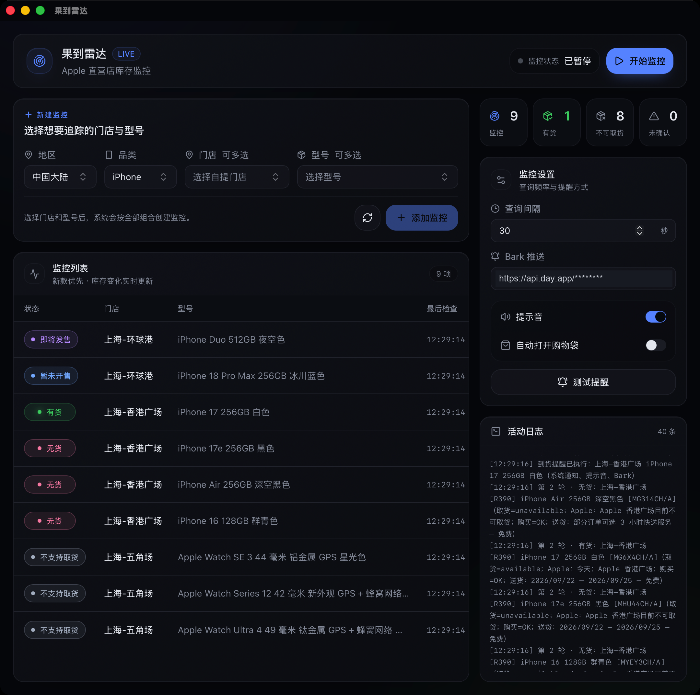

# 果到雷达

[](https://github.com/suversal/apple-store-inventory-monitor/actions/workflows/ci.yml)
[](package.json)
[下载与发布记录](https://github.com/suversal/apple-store-inventory-monitor/releases)
[](LICENSE)

果到雷达是一款 Apple 直营店取货库存监控工具。选好地区、门店和具体型号后，它会定时检查库存；检测到有货时，可以播放提示音、推送 Bark，并按你的选择打开 Apple 购物袋或商品详情。中国大陆直营店取货还可以开启[自动结账](#自动结账可选)：到货后由应用自己的浏览器走完结账页面，停在「查看订单」页等你确认。

支持 macOS、Windows 和 Linux，使用 Rust、Tauri 2 和 React 编写。果到雷达的正式版本从 **1.0.0** 开始，本 README 对应 `1.0.22` 源码。应用名称为 **果到雷达**，仓库名为 `apple-store-inventory-monitor`。

基于 [ENCHIGO/apple-pickup-watcher v0.3.2](https://github.com/ENCHIGO/apple-pickup-watcher/tree/v0.3.2) 继续开发，按 GPL-3.0-or-later 发布。来源与修改记录见 [NOTICE](NOTICE)。

> 本项目不是 Apple 官方软件，与 Apple Inc. 没有关系，也没有获得 Apple 授权。默认情况下它只负责查询和提醒，不能预留库存，也不会替你下单。只有你主动开启「自动结账」并打开其中的「自动点立即下单」时，它才会替你提交订单；任何情况下都不会替你付款。

[快速开始](#快速开始) · [下载安装](#安装) · [使用方法](#使用方法) · [自动结账](#自动结账可选) · [常见问题](#常见问题) · [从源码运行](#从源码运行) · [反馈问题](#反馈问题)

## 一图看懂

<p>
  
  
  
  
</p>

图中的界面为示意，门店、型号和节点均为示例。

## 界面预览

V1.0.20


V1.0.0


截图中的 Bark 密钥已遮挡；库存仅代表拍摄时结果。截图来自更新前的本地版本，日志中的旧提醒记录不代表当前版本提供系统通知。当前提醒方式为提示音、Bark 和可选的页面跳转。

## 快速开始

如果你只想使用软件，不需要安装 Rust、Node.js 或 pnpm。它们只供开发者从源码构建。

1. 按下方[安装说明](#安装)下载并安装适合自己电脑的版本。
2. 确认电脑已安装 Google Chrome 或 Microsoft Edge。Linux 也可以使用 PATH 中的 Chromium。Firefox、Safari、Brave 等浏览器目前不能用于库存查询。软件不会读取你平时使用的浏览器资料。
3. 打开果到雷达。macOS 和 Windows 可能会拦截未经公证或没有开发者证书的应用，处理方法见[安装](#安装)。
4. 如果想在 iPhone 上收到到货通知，先按 [Bark 教程](#bark-从下载到使用)安装并配置 Bark；不需要手机推送可以跳过。
5. 选择地区和品类，再勾选门店与型号，点击「添加监控」。
6. 选择提示音、Bark 和「到货后打开」方式，再点一次「测试提醒与跳转」。
7. 确认测试正常后点击「开始监控」。看到「未知」时先看活动日志，不要把它当成无货。
8. 如果经常出现「请求被 Apple 拦截」，并且电脑上装有 Clash，可以按[查询线路与 Clash 配置](#查询线路与-clash-配置)为查询单独设置出口。
9. 想让应用在到货后替你走完结账页面，按[自动结账](#自动结账可选)配置。这一项默认关闭，不用可以跳过。

Apple 可能限流或调整接口，库存也可能在提醒后立即变化。最终能否取货，以 Apple 官网下单时的结果为准。

## 运行要求

运行时需要以下任意一种浏览器：

- Google Chrome
- Microsoft Edge
- Chromium（Linux，需要能从 PATH 直接启动）

应用会自动查找常见安装位置。macOS 请把 Chrome 或 Edge 安装在系统的「应用程序」目录（`/Applications`）；放在其他目录可能无法识别。没有找到浏览器时，监控项会显示为「未知」，日志会说明原因。

目前只提供桌面版，不支持 iPhone、iPad 或 Android。Bark 只是把有货消息推送到 iPhone，真正的库存监控仍在电脑上运行。电脑休眠、关机或彻底退出应用后，监控也会停止。

## 安装

打开 [最新正式版本](https://github.com/suversal/apple-store-inventory-monitor/releases/latest)，在 **Assets** 中下载对应系统的安装包。每个版本的变化见 [更新记录](CHANGELOG.md)。

普通用户只需要下表中的安装包，不需要下载 `.sig`、`latest.json`、`.app.tar.gz` 或 GitHub 自动提供的 Source code 压缩包。

| 你的电脑 | 推荐下载 |
| --- | --- |
| Apple 芯片 Mac（M1、M2、M3、M4 等） | 文件名含 `aarch64` 的 `.dmg` |
| Intel 芯片 Mac | 文件名含 `x64` 的 `.dmg` |
| Windows x64（Intel / AMD） | `*-setup.exe` |
| Ubuntu 24.04 或更新的 64 位 Linux | `*_amd64.deb` 或 `*_amd64.AppImage` |

不知道 Mac 使用哪种芯片时，点击屏幕左上角苹果菜单，选择「关于本机」：显示 Apple M 系列就下载 `aarch64`，显示 Intel 就下载 `x64`。

### macOS

1. 打开 `.dmg`，把 `果到雷达.app` 拖进「应用程序」，不要直接在磁盘映像中长期运行。
2. 应用包已经过完整的 ad-hoc 签名，但暂未使用 Developer ID 证书，也未经过 Apple 公证。如果系统提示无法验证开发者，可以在 Finder 中按住 Control 点击应用并选择「打开」，或到「系统设置 → 隐私与安全性」确认被拦截的是本应用，再选择「仍要打开」。

`v1.0.2` 的 macOS 包曾因应用签名不完整而被系统误报为“已损坏”，此问题已在 `v1.0.3` 修复。如果新版仍显示旧提示，请先删除旧应用和旧 DMG，确认重新下载的文件名包含 `1.0.22`。确认安装包来自本仓库 Release 后，仍可执行：

```bash
xattr -dr com.apple.quarantine "/Applications/果到雷达.app"
```

然后重新打开应用。这条命令只移除该应用的下载隔离标记，不会关闭 macOS 的全局安全功能。不要对来源不明的应用执行这条命令。

### Windows

推荐使用 `*-setup.exe`。未签名版本可能触发 SmartScreen。确认文件来自本仓库 Release 后，可点击「更多信息」，再选择「仍要运行」。Windows 自带 Microsoft Edge，一般不需要另装浏览器。

### Linux

Release 提供 x64 的 `.deb` 和 `.AppImage`。安装包在 Ubuntu 24.04 上构建，需要 glibc 2.39 或更高版本；较老的发行版请从源码构建。

在终端进入安装包所在目录（例如 `cd ~/Downloads`），选择一种方式安装。以下命令中的文件名请替换为实际下载的文件名。

**Debian / Ubuntu：**

```bash
sudo apt install "./apple-store-inventory-monitor_1.0.22_amd64.deb"
```

`apt` 会同时安装包声明的依赖。音频播放和托盘还需要 ALSA 与 AppIndicator 运行库。

**AppImage：**

```bash
chmod +x "./apple-store-inventory-monitor_1.0.22_amd64.AppImage"
"./apple-store-inventory-monitor_1.0.22_amd64.AppImage"
```

AppImage 需要 FUSE 2。Ubuntu 24.04 可以用 `sudo apt install libfuse2t64` 安装；也可以不安装 FUSE，直接解包运行：

```bash
"./apple-store-inventory-monitor_1.0.22_amd64.AppImage" --appimage-extract-and-run
```

Linux 还需要自行安装 Chrome、Edge 或 Chromium。使用 Chromium 时，请确认终端可以运行 `chromium` 或 `chromium-browser`。

## 功能

- 支持 iPhone、iPad、Mac 和 Apple Watch。
- 内置中国大陆、中国香港、中国台湾、日本、新加坡、澳大利亚和马来西亚的 Apple Store 列表。
- 门店和型号都可以多选，添加时会自动生成全部组合。
- 同一门店的多个型号会合并查询；超过 Apple 单次稳定返回的 20 个零件号时自动分批，避免静默遗漏。
- iPhone 型号选择和监控列表按代际优先显示新款；型号名称保留可确认的容量、颜色和规格。
- 区分有货、无货、不支持取货、暂未开售、即将发售和暂不可购买，分别使用独立配色；查询失败保留为未确认状态。
- 监控列表同时展示门店取货日期和 Apple 预计送货日期；具体日期按送达速度着色，只有周数范围时保留 Apple 原文，不自行推算日期。
- 送货地区使用 Apple 官网提供的省、市、区三级选项；Apple Watch 可继续选择表带款式、颜色和腕围尺码，以完整表壳与表带组合查询送货信息。
- 同一型号和送货地址在不同门店之间共享送货结果：有效信息缓存 60 分钟，空结果缓存 5 分钟，到期后在监控查询中刷新；刷新失败会保留上次日期。修改送货地区后按新地址查询，退出应用后缓存不会保留。门店取货状态仍按设置的查询间隔更新。
- 支持提示音和 Bark 推送；可为不同型号指定不同的 Bark 地址，把到货消息分发给不同的人。Bark 推送还可以设置通知等级、铃声、音量、持续响铃与重复提醒。
- 有货时可以选择不自动打开页面、打开对应地区的 Apple 购物袋，或打开对应型号的商品详情；也可以点击监控列表中的型号手动打开商品详情。
- 可选「到货后暂停监控」：普通监控在到货后暂停；开启自动结账时，失败继续监控重试，完成结账或需要人工确认订单结果后才暂停。
- 可选自动结账（仅中国大陆直营店取货）：到货后用应用专属的下单浏览器从购物袋依次完成取货门店与时段、取货联系人、付款方式，停在「查看订单」页；也可以设置为核对通过后自动点「立即下单」。付款始终由你自己完成。详见[自动结账](#自动结账可选)。
- 可通过 Clash 为库存查询单独指定出口，或在多个节点之间自动轮换，减少被 Apple 拦截；不影响电脑本身使用的节点。详见[查询线路与 Clash 配置](#查询线路与-clash-配置)。
- 窗口关闭后可继续在系统托盘运行。
- 默认使用内置的门店列表和型号目录；点击刷新按钮可从 Apple 官网更新门店和当前品类的型号，更新结果保存在本机，重启后继续使用。网络失败时继续使用已有目录。
- 活动日志逐轮显示每项状态、门店编号、商品零件号及 Apple 返回的取货、购买和配送说明，并按状态汇总。
- 支持应用内检查更新。

## 使用方法

下面按照第一次使用的顺序操作。Bark、提示音和自动打开页面都是可选项，至少配置一种自己需要的提醒方式即可。

### 第一步：打开应用并做好准备

1. 先正常打开一次 Chrome 或 Edge，确认它能访问 Apple 官网；Linux 也可以使用 Chromium。
2. 再打开果到雷达，等待界面显示地区、品类和门店选项。
3. 如果需要手机通知，先在 iPhone 上配置 Bark；如果只需要电脑播放提示音，可以跳过 Bark。

果到雷达必须在电脑上保持运行。Bark 只负责把通知送到 iPhone，不能代替电脑查询库存。电脑睡眠、关机或彻底退出果到雷达后，监控都会停止。

### 第二步：添加要监控的商品

1. 选择地区和品类。
2. 在门店下拉框中勾选一家或多家门店。
3. 在型号下拉框中搜索并勾选一个或多个具体配置。容量、颜色、尺寸或连接类型不同，会被视为不同型号。
4. 点击「添加监控」。

门店和型号会按组合添加。例如，选择 2 家门店和 3 个型号，会生成 6 条监控。已存在的组合会被跳过。

门店和型号默认使用应用内置的目录。找不到刚发布的型号或新开的门店时，点击「添加监控」旁边的刷新按钮，从 Apple 官网更新门店列表和当前品类的型号，活动日志会显示更新结果。刷新结果保存在本机，重启后继续使用；刷新不会替换已经保存的监控项。使用「指定节点」或「Clash 节点轮换」时，刷新请求也经由相同的 Clash 专用端口；如果当前节点无法访问该地区官网（例如家庭宽带直连访问 `www.apple.com` 被断开），会自动改用系统网络刷新，并在日志中说明。机型出现在列表中不代表它已经开放预购或门店取货；旧型号已下架或 Apple 暂时没有取货数据时，可能显示「暂无数据」。

切换地区会清空上方尚未添加的门店和型号选择，但不会删除已经在监控列表中的项目。

### 第三步：选择到货后的提醒方式

- **提示音**：打开后，电脑检测到有货时会播放声音。请确保系统没有静音。
- **默认 Bark 推送**：适合把所有商品的提醒发送到同一台 iPhone。
- **型号专属 Bark**：适合把某个型号的提醒发送给其他人，或者发送到另一台 iPhone。
- **Bark 推送增强**：在 Bark 地址下方可以设置通知等级（`active`／`timeSensitive`／`passive`／`critical` 重要警告）、铃声、音量（仅重要警告生效）和持续响铃（重复播放铃声约 30 秒；配合重要警告可在静音、勿扰下持续响铃）。开启「重复提醒」后，检测到有货会在设定的时长内每隔几秒再提醒一次，重新检测到有货会重新计时。这些提醒都在后台发送，不影响查询节奏；全部留空或保持默认时，行为与旧版一致。
- **到货后打开**：可以选择「不自动打开」「购物袋」「跳转至教育商店购物袋」或「商品详情」。这些选项只负责在你平时使用的浏览器中打开页面，不会自动加入购物袋、预留库存或下单。教育商店的购买资格及优惠商品以 Apple 页面为准。
- **到货后暂停监控**：打开后，任意一条监控到有货就暂停监控，本轮的提醒照常执行，之后需要手动点「开始监控」。默认关闭。

持续有货时，每一轮都会再次执行已经开启的提醒。如果不想浏览器反复出现新页面，请把「到货后打开」设为「不自动打开」；如果只想被提醒一次，请打开「到货后暂停监控」。

「到货后打开」与自动结账互不相关：前者在你平时使用的浏览器中打开页面，后者在应用专属的下单浏览器中操作。开启自动结账后，建议把「到货后打开」设为「不自动打开」，避免同时弹出两个窗口。

### Bark 从下载到使用

Bark 是一款把自定义通知推送到 iPhone 或 iPad 的独立应用。它不是必需组件：不使用 iPhone，或者只想听电脑提示音时，可以完全跳过这一节。

#### 1. 在 iPhone 上下载 Bark

打开 [App Store 中的 Bark](https://apps.apple.com/cn/app/bark-%E7%BB%99%E4%BD%A0%E7%9A%84%E6%89%8B%E6%9C%BA%E5%8F%91%E6%8E%A8%E9%80%81/id1403753865)，或者在 App Store 搜索完整名称 **“Bark - 给你的手机发推送”**。安装后打开 Bark，并允许它发送通知。Bark 的源代码和官方说明可在 [Finb/Bark](https://github.com/Finb/Bark) 查看。

#### 2. 找到自己的 Bark 推送地址

打开 Bark 首页，找到并复制它显示的推送地址或测试 URL。果到雷达需要的是“服务器地址 + 设备 Key”，通常形如：

```text
https://api.day.app/你的设备Key
```

如果 Bark 显示的是下面这种带测试文字的完整地址：

```text
https://api.day.app/你的设备Key/这里改成你自己的推送内容
```

只把前半段 `https://api.day.app/你的设备Key` 填入果到雷达，不要把最后的测试文字一起粘贴。使用自建 Bark 服务器时规则相同：地址必须以 `http://` 或 `https://` 开头，并且路径中包含设备 Key。

设备 Key 相当于这台设备的推送凭证。不要把真实地址发到群聊、截图、公开 Issue 或代码仓库中。

#### 3. 填入果到雷达

1. 回到电脑上的果到雷达。
2. 在右侧「默认 Bark 推送」输入框粘贴地址。
3. 点击输入框外的空白位置，让设置保存。
4. 如果所有型号都推送到同一台手机，到这里就配置完成了。

想让某个型号推送给另一台手机时，先添加该型号的监控，再点击监控列表 Bark 一栏中的「默认」，在弹窗中填写另一条 Bark 地址并保存。按钮会变成「专属」。同一型号即使监控多家门店，也共用这一条专属地址；清空专属地址并保存，就会恢复使用默认 Bark。

#### 4. 先测试，再开始监控

点击「测试提醒与跳转」，然后检查：

1. iPhone 是否收到标题为“提醒测试（不代表有货）”的通知。
2. 果到雷达活动日志是否显示 Bark 已执行，还是给出了失败原因。
3. 如果配置了型号专属 Bark，测试会使用监控列表中第一个型号的地址；因此测试专属地址前，应先把对应型号添加到列表。

测试按钮不会查询 Apple 库存，也不代表商品有货。只有手机实际收到通知，才能确认 Bark 链路已经可用。

### 第四步：测试其他提醒和页面跳转

「测试提醒与跳转」还会测试当前开启的提示音和「到货后打开」选项：

- 选择「购物袋」时，会打开当前地区的 Apple 购物袋。
- 选择「跳转至教育商店购物袋」时，会打开当前地区的 Apple 教育商店购物袋。
- 选择「商品详情」时，需要先添加监控目标；测试会打开列表中第一个型号的商品页。
- 选择「不自动打开」时，不会打开浏览器，Bark 通知中也不会附带页面链接。

如果只想测试某一项，可以暂时关闭其他提醒。测试完成后，再恢复自己真正需要的设置。

### 第五步：开始监控

1. 点击右上角「开始监控」。
2. 等待第一轮完成，在监控列表和活动日志中查看每个项目的结果。
3. 需要暂时停止查询时，点击「暂停监控」。
4. 关闭主窗口后，应用会留在系统托盘继续运行；需要完全退出时，请从托盘菜单选择「退出」。

重新打开应用会恢复已保存的监控列表，但需要再次点击「开始监控」。

### 查看结果

监控列表中的「最后检查」表示该条目最近一次完成查询的时间。活动日志会在每轮结束后显示类似内容：

```text
第 2 轮 · 无货：上海-香港广场 [R390] iPhone Air…（取货=unavailable；购买=OK…）
第 2 轮 · 不支持取货：上海-五角场 [R581] Apple Watch…（取货=ineligible…）
第 2 轮 · 有货：上海-环球港 [R683] iPhone 17…（取货=available；Apple：今天…）
第 2 轮完成（4.4 秒，实际请求 1 次，批量响应覆盖 2 家门店）：无货 1 项、不支持取货 1 项、有货 1 项。约 30 秒后查询。
```

第一条商品有货不会停止本轮查询。监控引擎会继续处理剩余门店和型号；持续有货时，每一轮都会再次执行已启用的提醒动作。打开「到货后暂停监控」后，本轮查完即暂停，日志会显示「监控到有货，已按设置暂停监控。」

### 查询间隔

默认查询间隔为 30 秒，界面允许的下限是 5 秒。日常使用建议保留 30 秒或更长，避免频繁请求触发 Apple 风控。

间隔从本轮查询结束后开始计算。例如设置为 30 秒，正常取得库存结果时，会在本轮结束 30 秒后开始下一轮；整轮查询本身的耗时另计。

同一地区、相同型号组合的附近门店会优先复用首个响应；响应没有包含目标门店或型号时才补发请求。为避免瞬时请求突发，任意两次真实库存请求之间仍至少间隔 2 秒，但成功的正常轮次不会再因累计额度延后下一轮。

Apple 返回 `403`、`541` 或 `429` 时，处理方式取决于「查询线路」：跟随系统代理和指定节点模式下，当轮同地区不再重复请求，下一轮按设定间隔继续重试；Clash 节点轮换模式下，被拒的节点进入冷却并立即换下一个节点，所有节点都不可用时，下一轮等到最早恢复的节点。界面倒计时和日志会显示调度器实际采用的等待时间。

### 自动结账（可选）

自动结账默认关闭。可选择使用预先准备的购物袋，或开启「按到货型号自动加入购物袋」：监控列表里哪个中国大陆型号有货，就为哪个型号加购 1 件，再选择取货门店与时段、填写取货信息、选择付款方式，最后停在「查看订单」页或按设置提交订单。成功后是否关闭总开关由「成功后关闭自动结账」决定，默认保持原有单次行为。

#### 适用范围与限制

- 只支持**中国大陆**的**直营店取货**，不支持送货，也不支持其他地区。
- 一次只买**一件**商品，数量为 1。购物袋里必须只有这一件。
- 应用**不会替你付款**。无论是否自动点「立即下单」，支付宝、微信或分期的付款都需要你自己在下单浏览器里完成。
- 需要你事先在专属下单浏览器里登录 Apple 账户。自动加购支持有独立商品页、无需额外组合配置的型号；不支持另选表带等组合配置。会选择不折抵换购、不加 AppleCare，跳过推荐配件。关闭自动加购时仍需事先放好指定商品。
- 结账流程依赖 Apple 结账页面当前的结构。Apple 调整页面后可能失效，应用会记录失败步骤和原因；提交订单前失败会关闭本次下单窗口，下一次有货时重新尝试。
- 目前只在 macOS 上实际验证过。

#### 为什么要用单独的下单浏览器

自动结账使用应用专属的浏览器窗口和资料目录，与你平时使用的 Chrome 或 Edge 完全分开，不会读取其中的登录状态、Cookie 或浏览记录。因此需要在这个窗口里**单独登录一次 Apple 账户**。登录状态保存在应用自己的资料目录中，关闭窗口或重启应用后仍然有效，直到 Apple 要求重新登录。

下单浏览器与后台查询库存用的无头浏览器也是分开的，两者互不影响。

#### 第一次使用

1. 先把要买的商品加入监控列表（中国大陆门店）。
2. 展开右侧「自动结账」，点击「打开下单浏览器」。
3. 在打开的窗口里登录 Apple 账户。使用自动加购时，建议先**手动清空专属购物袋**，减少失败清理的等待。提交前失败会清空整个专属购物袋，请勿在其中保存其他商品。使用预先准备购物袋的模式时，只放指定商品 1 件。
4. **手动走一次结账流程**，一直走到「查看订单」页，不必下单。这一步让 Apple 记住你的取货联系人等信息，也能提前发现账户是否需要额外验证。
5. 回到果到雷达，按下一节填写设置。
6. 点击「试跑到查看订单页」。试跑不看库存；自动加购模式用列表中第一件中国大陆商品，旧模式用「要下单的商品」，门店用对应的第一条监控项。**无论设置如何都不会提交订单**。手动试跑失败保留页面供检查。
7. 试跑通过后，打开「到货后自动结账」，再点「开始监控」。

「到货后自动结账」开关需要填好证件号码后四位。自动加购模式须至少监控一件中国大陆商品；关闭自动加购时还需要确定「要下单的商品」。

#### 设置项

| 设置 | 说明 |
| --- | --- |
| 到货后自动结账 | 总开关；成功后是否自动关闭由下方选项决定 |
| 成功后关闭自动结账 | 默认开启，兼容原来的单次行为；关闭后成功仍保持总开关开启，监控继续运行时可再次结账，可能生成多笔真实订单并切换当前结账页面 |
| 按到货型号自动加入购物袋 | 默认关闭，兼容原来的购物袋流程。打开后任一中国大陆监控型号到货都可触发，加购后核对 SKU、名称和数量；提交前失败后清空专属购物袋并刷新确认，再关闭页面重试；清理未成功时保持开关，下次先继续清理 |
| 要下单的商品 | 只在关闭自动加购时显示：只监控一件商品时自动认定，多件时须选购物袋里放的那一件 |
| 取货人证件号码后四位 | Apple 每次结账都要求填写，必须与取货时出示的证件一致 |
| 按下面的信息填写取货联系人 | 关闭时沿用 Apple 预填的联系信息，只检查有没有缺项。打开后可填写姓氏、名字、电子邮件地址和手机号码（不带 +86），会覆盖结账页上预填的内容，留空的项沿用页面上已有的值。姓名须与取货证件一致，下单后无法更改 |
| 付款方式 | 支付宝、微信支付或分期付款 |
| 分期方案与期数 | 付款方式为分期付款时出现。方案可选花呗分期、微信分付、招商银行、中国建设银行、工商银行；花呗分期最多 12 期。结账页上没有所选期数时会停下，并列出可选的期数 |
| 优先用结账页默认选中的门店 | 见下方[取货门店怎么选](#取货门店怎么选) |
| 核对通过后自动点「立即下单」 | 默认关闭，停在「查看订单」页由你自己点。打开后会生成真实订单，下单后取货信息无法更改，付款仍需你在 Apple 规定的时间内自己完成 |

#### 取货门店怎么选

进入结账页并切换到「我要取货」后，应用会沿用已有的目标门店列表或符合设置的默认门店。官网尚未设置取货地区，或列表里没有目标门店及可接受的默认门店时，会根据目标门店的省、市和公开地址补齐取货地区，再查询门店；无法唯一匹配时停下并提示手动选择。这一步不需要浏览器定位权限。

Apple 可能默认选中取货地区附近的一家有货门店。换成另一家门店需要再等 Apple 响应一次，大约多花十几秒。

- **关闭「优先用结账页默认选中的门店」（默认）**：只在监控到货的门店取货。如果 Apple 默认选中的门店恰好也在这件商品的监控列表里并且可取货，就直接用它；否则改选到货的那一家。
- **打开**：只要 Apple 默认选中的门店可以取货，就直接在那里取货，即使它不是监控到货的那一家。速度更快，但取货地点可能不是你监控的门店。

取货时段沿用页面上已经选好的；没有选好时，选择列表中的第一个可用时段。实际使用的门店会写在完成通知里。

#### 到货时会发生什么

1. 自动加购模式下任一中国大陆监控型号确认有货，或旧模式的指定商品有货时，照常提醒并启动一次自动结账。多个型号同时有货时不会排队启动多次结账。
2. 自动加购先确认购物袋为空，再打开本次到货型号的商品页并加购；已恰好为本次型号 1 件时直接沿用，不重复添加。核对购物袋必须只有本次型号、数量为 1。出现其他商品或数量不符时结束本轮，清空专属购物袋后等待下次到货重新加购，不会夹带商品购买。
3. 选择取货门店和时段，填写取货信息，选择付款方式。
4. 到「查看订单」页后再核对一次商品。
5. 未打开自动下单时，在这里停下并通知你；打开时点一次「立即下单」，然后读取订单号并通知你。

完成后会收到以下通知之一：

| 通知 | 含义 |
| --- | --- |
| 已到查看订单页 | 流程走完，等你在下单浏览器里点「立即下单」并付款 |
| 已提交订单，请尽快付款 | 订单已提交。读到订单号时会一并显示；没有读到时会提示你到下单浏览器里确认订单是否成立 |
| 自动结账没有完成 | 在提交订单之前的某一步失败，通知中会写明失败步骤和原因；本次下单窗口自动关闭，监控继续运行时下次有货会重新尝试 |
| 提交订单时出错，请确认结果 | 点「立即下单」之后出了问题，订单可能已经生成，请立即到下单浏览器里确认 |

#### 防止误下单和重复下单

- 购物袋内容与到货型号不一致、多于一件或数量不是 1 时，不会继续结账；自动加购模式结束本轮并清空后重试。
- 「立即下单」只点一次，之后无论页面如何都不会重试。
- 同一时间只运行一次结账。结账过程中其他轮次再次查到有货，只执行提醒，不会重复启动，也不会打断正在进行的那一次。
- 「成功后关闭自动结账」默认开启；用户可关闭它，让到达查看订单页或已确认提交订单后仍保持总开关开启。监控继续运行时，持续有货可再次结账，可能生成多笔订单。
- 提交订单时出错或没有读到订单号时仍关闭自动结账，因为此时无法确定订单是否已经生成，不受成功后关闭选项影响。
- 「试跑到查看订单页」永远不提交订单。

#### 失败后会不会重试

在提交订单之前的步骤失败时，自动加购模式会先清空专属购物袋，等空袋提示出现，再刷新购物袋确认清理完成，之后关闭本次专属下单窗口。登录资料仍然保留，「到货后自动结账」仍然保持打开。关闭自动加购时沿用原来的购物袋，不删除商品。监控继续运行且商品有货时，下一轮查询会重新打开下单浏览器，从购物袋开始再试一次，不会停留在之前失败的页面，并再次提醒。后台库存查询浏览器不受影响。

例如首发抢购时，监控查到有货，进入结账后库存已经被抢空：购物袋、结账跳转或核对页读到可见的失败提示后，会关闭本次下单窗口，回到监控，等下一次确认有货再开始。按钮已禁用或消失、明确没有点击到「立即下单」时，也按提交前失败处理。已发起提交但响应超时的情况仍需人工确认，不能仅凭没有读到订单号就重新下单。

- 失败原因是临时的（例如 Apple 页面响应超时），重试可能成功。
- 清理暂时失败时保留“待清理”状态，关闭本次窗口，保持自动结账和监控。下次有货先重新打开购物袋继续清理，确认服务端为空后才允许加购；不会沿用旧失败商品或叠加数量，没有固定的失败次数上限。
- 登录页面临时读取失败或等待超时会清理后等待下次重试。明确密码错误、账户不一致或需要验证码时，保留登录页和自动结账开关，不跨轮次重复提交密码；请在保留页面完成登录并停在取货方式页。后续到货确认登录恢复后，先完成待清理任务，再重新加购，无需重新开启开关。

开启「到货后暂停监控」也不会中断自动结账的失败重试：自动结账开启时，会等到「查看订单」页、提交订单或需要人工确认提交结果后才暂停。想停止重试时，可以手动暂停监控，或关闭「到货后自动结账」。

#### 监控多件商品时

开启「按到货型号自动加入购物袋」后，无需把监控列表限制为一个型号：任一中国大陆型号有货都可触发。一次只处理一件；提交前失败会清理空袋，再等待下一次有货，下一次可以换成另一个型号。到查看订单页或已确认提交订单后，按用户设置决定是否保持自动结账；提交结果不明时仍停止并保留页面供确认。

关闭自动加购时，仍只认「要下单的商品」这一件：

- 这件商品到货：执行自动结账。它在多家门店都被监控时，哪一家先确认有货就用哪一家。
- 其他商品到货：只提醒，不结账。
- 从监控列表里删掉了被选中的商品：选择会被清空，自动结账随之关闭。
- 监控列表里有多件商品而没有选择：无法开启自动结账。

两种模式均遵循「成功后关闭自动结账」选项。关闭此项且保持监控运行时，可持续触发新的结账；用户需自行控制总开关和处理待付款订单。

### 查询线路与 Clash 配置

Apple 按出口 IP 统计请求次数，同一 IP 连续查询一定次数后会返回 HTTP 541，并在十几分钟内持续拒绝。实测中不同出口的额度差异很大：家庭宽带有时十几次请求就被拒，部分机场节点可以撑过数十次。如果你经常看到「请求被 Apple 拦截」，可以在右侧「查询线路」中为查询单独指定出口，或让程序在多个 Clash 节点之间自动轮换。

不使用 Clash 的用户保持默认的「跟随系统代理」即可，本节可以跳过。

#### 三种出口方式

| 出口方式 | 适合谁 | 行为 |
| --- | --- | --- |
| 跟随系统代理（默认） | 不使用代理，或不想改动 Clash | 与旧版本一致。开着 Clash 系统代理或 TUN 时，出口由 Clash 规则决定 |
| 指定节点 | 想固定用某个节点，或固定用家庭宽带 | 经 Clash 专用端口固定使用一个节点，不自动切换。选 DIRECT 即使用本机网络，Clash 开着 TUN 也有效 |
| Clash 节点轮换 | 有机场订阅、经常被拦截 | 平时一直用当前节点；被 Apple 拒绝时冷却该节点并立即换下一个 |

Clash 节点轮换的具体规则：

- 节点被 Apple 拒绝（`541`、`403`、`429`）后冷却 5 分钟；冷却结束后的第一次请求仍被拒，则依次延长到 10、20、30 分钟，成功一次即恢复。
- 切换前先对目标节点测速，测不通的节点跳过 60 秒，直接试下一个。测速地址为 `https://www.gstatic.com/generate_204`，不消耗 Apple 的请求额度；DIRECT 不参与测速。
- 连续 10 个不同节点都被 Apple 拒绝时，本轮停止切换，因为这通常说明拦截的不只是 IP。
- 所有节点都不可用时，下一轮等到最早恢复的节点，界面显示「冷却中」和倒计时。
- 可以在「当前节点」中手动指定节点，手动指定会解除该节点的冷却；之后被拒时仍会自动切换。

「查询线路」面板里还有一个「被 Apple 拒绝后重建浏览器会话」开关，默认关闭。开启后，程序会为每次真实查询记账：**最近 10 次查询里被拒次数超过半数（且至少累计 4 次查询）**时，才关闭当前查询浏览器，下一次真正发请求时改用新建的会话重试，而不是复用被拒的旧会话——被 `403`、`541` 或 `429` 拒绝（包括返回验证页的情况）都算被拒；偶发一两次被拒未过半时，继续复用原会话探测，不会推倒重来。重建需要几秒钟重新启动浏览器，浏览器的资料目录和 Cookie 仍然保留。关闭时保持默认行为：按设定间隔复用同一会话继续探测。

两种 Clash 模式都**只切换果到雷达专用的策略组，只让查询浏览器使用专用端口**，电脑上其他软件使用的节点不受影响。

#### 配置 Clash（以 Clash Verge Rev 为例）

需要使用 mihomo（Clash Meta）内核。Clash Verge Rev 默认就是 mihomo 内核。

**第一步：开启外部控制器**

1. 打开 Clash Verge，进入「设置」→「Clash 设置」→「外部控制」。
2. 打开「启用外部控制器」，监听地址填 `127.0.0.1:9097`。
3. 设置一个「API 访问密钥」并记下来，稍后要填到果到雷达里。
4. 点「保存」。

**第二步：添加果到雷达专用的扩展脚本**

1. 进入「订阅」页面，在页面底部找到 **「全局扩展脚本」**（右上角标着 `Script`）。
2. 右键点击它，选择「编辑文件」。
3. 把编辑器里原有的内容**全部替换**成下面的脚本。
4. 在 `APW_SUBSCRIPTIONS` 中填写机场订阅地址。每行一个，左边是机场名（只用于给节点加前缀），右边是订阅地址；有几个机场就写几行。订阅地址可以在对应订阅卡片上右键复制，或到机场官网复制。
5. 保存。如果「代理」页面没有刷新，在当前使用的订阅卡片上点一下刷新。

```javascript
// Clash Verge「全局扩展脚本」：节点只供果到雷达的专用端口使用，不影响电脑本身的节点
const APW_PREFIX = "APW·";
const APW_GROUP = "果到雷达";
const APW_SUBSCRIPTIONS = {
  机场1: "机场订阅地址",
};

function main(config, profileName) {
  const providers = config["proxy-providers"] || {};
  const used = [];
  for (const [label, url] of Object.entries(APW_SUBSCRIPTIONS)) {
    if (!/^https?:\/\//.test(url)) continue;
    const key = `apw-${label}`;
    providers[key] = {
      type: "http",
      url,
      interval: 86400,
      path: `./providers/${key}.yaml`,
      override: { "additional-prefix": `${APW_PREFIX}${label}|` },
      "health-check": { enable: false },
    };
    used.push(key);
  }
  config["proxy-providers"] = providers;

  // 原有策略组若自动收录全部节点（include-all / include-all-providers），排除专用节点
  const guard = `^${APW_PREFIX}`;
  const groups = (config["proxy-groups"] || []).filter((g) => g.name !== APW_GROUP);
  for (const group of groups) {
    if (group["include-all"] || group["include-all-providers"]) {
      const old = group["exclude-filter"];
      if (old && old.includes(guard)) continue;
      group["exclude-filter"] = old ? `(?:${old})|${guard}` : guard;
    }
  }
  groups.push({ name: APW_GROUP, type: "select", proxies: ["DIRECT"], use: used });
  config["proxy-groups"] = groups;

  const listeners = (config.listeners || []).filter((l) => l.name !== "apple-store-monitor");
  listeners.push({ name: "apple-store-monitor", type: "mixed", port: 7899, listen: "127.0.0.1", proxy: APW_GROUP });
  config.listeners = listeners;
  return config;
}
```

脚本做了三件事：把订阅节点加上 `APW·机场名|` 前缀，放进新建的「果到雷达」策略组；让原有策略组排除这些节点，电脑本身的分流保持不变；开一个只转发到「果到雷达」组的本机端口 `7899`。

> 不要把这些配置写进「全局扩展覆写配置」（Merge）。新版 Clash Verge 的 Merge 不支持追加策略组，写成 `proxy-groups` 还会替换原有的全部策略组，导致电脑分流异常。
>
> 订阅地址相当于账号凭证，不要截图、分享或提交到公开仓库。

**第三步：确认 Clash 已生效**

在 Clash Verge 的「代理」页面检查：

- 出现了名为「果到雷达」的策略组，里面有 DIRECT 和带 `APW·` 前缀的节点。
- 你平时使用的策略组（例如「节点选择」「自动选择」）中**没有**出现 `APW·` 开头的节点。如果出现了，说明脚本没有生效，或者使用了旧版写法，请重新按第二步操作。

**第四步：在果到雷达中填写**

1. 展开右侧「查询线路」，出口方式选择「Clash 节点轮换」或「指定节点」。
2. 按下表填写：

   | 项目 | 填写 |
   | --- | --- |
   | 控制接口 | 第一步的监听地址，例如 `127.0.0.1:9097`，可直接粘贴，程序会自动补上 `http://` |
   | 密钥 | 第一步设置的 API 访问密钥 |
   | 专用端口 | `7899`（与脚本中的 `port` 一致） |
   | 策略组 | `果到雷达`（与脚本中的 `APW_GROUP` 一致） |
   | 节点关键词 | 可留空；只想用部分节点时填关键词，用竖线分隔，例如 `香港\|台湾\|日本` |

3. 点「检查线路」。正常情况下会显示内核版本、可用节点数量和「端口 7899 可连接」。这一步只访问本机的 Clash，不会请求 Apple。
4. 在「当前节点」（指定节点模式下为「指定节点」）下拉框中查看各节点的延迟，需要时手动选择。
5. 点「开始监控」。活动日志每轮结束时会显示「线路：Clash 节点 …」，被拒或切换节点时也会记录。

「查询线路」面板中的「配置教程」按钮包含与本节相同的分步说明，并可一键复制与当前端口、策略组对应的脚本。

#### 使用建议

- **查询间隔建议保持 30 秒或更长。** 间隔越短，每个节点的额度消耗越快，切换越频繁。
- **不想优先使用家庭宽带时**，把脚本中的 `proxies: ["DIRECT"]` 改成 `proxies: []`。脚本默认把 DIRECT 排在第一位，平时优先走本机网络，被拦截后再切换到机场节点。
- **优先使用延迟低的地区**，例如在「节点关键词」中填 `香港|台湾|日本|新加坡`。
- **某个机场的节点全部测速超时**时，说明该订阅当前不可用，可以从 `APW_SUBSCRIPTIONS` 中删掉。
- 机场的多个节点可能共用同一个出口 IP，也可能与其他用户共用，因此节点数量多不代表不会被拦截。
- 控制接口密钥以明文保存在本机设置文件中。

#### 其他 Clash 客户端

只要客户端使用 mihomo 内核，并且能满足以下三点，就可以使用：

1. 开启外部控制器（`external-controller`），并设置密钥（`secret`）。
2. 有一个 `select` 类型的策略组，只供果到雷达使用。
3. 有一个 `listeners` 端口，`proxy` 指向这个策略组。

直接编辑 mihomo 配置文件时，可参考：

```yaml
external-controller: 127.0.0.1:9097
secret: "你的密钥"
proxy-providers:
  apw-airport1:
    type: http
    url: "机场订阅地址"
    interval: 86400
    path: ./providers/apw-airport1.yaml
    override:
      additional-prefix: "APW·机场1|"
proxy-groups:
  # 保留原有策略组，只在末尾追加这一个；原有使用 include-all 的组需加上 exclude-filter: "^APW·"
  - name: 果到雷达
    type: select
    proxies: [DIRECT]
    use: [apw-airport1]
listeners:
  - name: apple-store-monitor
    type: mixed
    port: 7899
    listen: 127.0.0.1
    proxy: 果到雷达
```

#### Clash 配置常见问题

| 检查线路或日志提示 | 原因与处理 |
| --- | --- |
| 无法连接 Clash 控制接口 | 外部控制器没有开启，或地址、端口与设置不一致。按第一步检查 |
| Clash 控制接口拒绝访问，请检查密钥 | 密钥填错，或 Clash 中修改了密钥 |
| Clash 中没有名为「果到雷达」的策略组 | 扩展脚本没有生效：确认写在「全局扩展脚本」而不是 Merge，已保存，并刷新了订阅 |
| 「果到雷达」的类型不是 select | 策略组类型需要是 `select`，程序才能切换节点 |
| 端口 7899 无法连接 / 无法连接 Clash 专用端口 | 脚本中的 `listeners` 没有生效，或端口被占用；确认脚本已保存，必要时换一个端口，并同步修改果到雷达中的「专用端口」 |
| 可用节点为 0，或某个机场没有节点 | 订阅地址填错，或该订阅在国内无法直接下载；到 Clash 的日志中查看订阅加载错误 |
| 电脑平时用的策略组里出现了 `APW·` 节点 | 使用了旧版配置或 Merge 写法，请按第二步改用本节的脚本 |

### 应用更新

应用启动后会静默检查 GitHub Releases。发现新版本时，界面会显示版本号和「下载并安装」按钮；更新不会在后台自动安装。更新时会显示累计下载量，以及验证、安装阶段；安装完成后需要重启应用，再点击「开始监控」。失败时会显示原因并提供重试或完整安装包入口。签名验证失败会停止安装，不会跳过验证；遇到签名密钥不匹配时请下载完整安装包替换旧版。

macOS 应用包使用完整的 ad-hoc 签名，但没有 Developer ID 证书且尚未公证；Windows 安装包也没有操作系统层面的开发者证书，因此仍可能出现 Gatekeeper 或 SmartScreen 提示。自动更新包另行使用本项目独立的 Tauri 更新密钥签名，用于阻止应用安装被篡改的更新包。

## 状态与颜色说明

同一种状态使用相同颜色，不同业务状态使用独立配色；深色和浅色主题都保留文字标签，便于直接辨认。

| 状态 | 颜色 | 含义 | 是否到货提醒 |
| --- | --- | --- | --- |
| 待查询 | 淡灰、虚线边框 | 尚未完成首次查询 | 否 |
| 有货 | 绿色 | Apple 返回 `available`，所选门店可取货 | 是，每轮确认有货都会提醒 |
| 无货 | 粉红色 | Apple 返回 `unavailable`，所选门店当前不可取货 | 否 |
| 不支持取货 | 石板灰 | Apple 返回 `ineligible`，当前商品或购买组合不适用取货服务，不能据此认定门店库存为零 | 否 |
| 暂未开售 | 蓝色 | `NOT_FOR_SALE` 且 Apple 文案明确说明尚未发售 | 否 |
| 即将发售 | 紫色 | Apple 返回 `COMING_SOON`，不代表已经可以下单 | 否 |
| 暂不可购买 | 金黄色 | `NOT_FOR_SALE`，但没有明确的尚未发售文案 | 否 |
| 未确认结果 | 橙色 | 根据原因显示「暂无取货数据」「未返回型号」「请求被拦截」「请求被限流」「查询失败」等，不能当作无货 | 否 |

取货、购买和配送是独立信息：购买状态 `OK` 不代表门店有货；配送日期也不是门店可取货日期。`SELL_IN_KIT_ONLY_RESTRICTION` 是购买限制字段，仅凭它不能判断门店库存或认定全部购买组合都不支持取货，请到官网核对完整配置。

有货以明确的取货结果为准，不会被送货说明覆盖。概览中的「不可取货」合计包括无货、不支持取货及尚不可购买的项目；「未确认」表示本轮没有可信结论。请结合逐项标签和日志查看具体原因。

### 为什么会有「未知」或未确认结果

查询失败和无货是两回事。请求被拦截、超时、限流、响应解析失败，以及 Apple 没有返回对应门店或型号的数据，都不能确认库存。程序会保留具体原因；遇到「暂无取货数据」或「未返回型号」时，请刷新型号目录并核对官网是否仍销售该型号、是否已开放取货。

## 设置与数据

新包使用独立的应用标识 `com.suversal.apple-store-inventory-monitor` 和配置目录。
首次启动时会从改名前的 `apple-pickup-watcher` 目录读取并复制现有设置；旧文件不会
被修改或删除，旧包仍可读取原有设置。迁移后两套配置独立，新版中新增或修改的监控项不会同步回旧包。

| 系统 | 设置文件 |
| --- | --- |
| macOS | `~/Library/Application Support/apple-store-inventory-monitor/settings.v2.json` |
| Windows | `%APPDATA%\apple-store-inventory-monitor\settings.v2.json` |
| Linux | `~/.config/apple-store-inventory-monitor/settings.v2.json`；设置了有效的绝对路径 `$XDG_CONFIG_HOME` 时，改用该目录下的 `apple-store-inventory-monitor/settings.v2.json` |

设置文件包含监控目标、查询间隔、提醒选项、查询线路和自动结账设置。Bark 地址、Clash 控制接口密钥，以及自动结账中填写的证件号码后四位、取货人姓名、电子邮件地址和手机号码都会以明文保存在本机，请不要将该文件上传到公开 issue 或提交进 Git 仓库。

自动登录的 Apple 账户和密码单独以明文保存在同目录的 `checkout-login.json`；Unix 上目录权限为 `0700`、文件权限为 `0600`，Windows 沿用当前用户配置目录的访问控制。密码不会返回给前端状态查询或写入活动日志。请勿分享这个文件；原钥匙串条目不会自动读取或迁移，升级后可在软件里重新保存登录信息。

同一目录下还有两个浏览器资料目录：`chromium-profile-v1/` 供后台库存查询使用；`checkout-profile-v1/` 供自动结账的下单浏览器使用，其中保存着你在下单浏览器里登录的 Apple 账户会话。想退出这个登录状态，可以在下单浏览器里退出账户，或在应用退出后删除 `checkout-profile-v1/`。两个目录都不要分享给他人。

点击刷新按钮后从 Apple 官网更新的门店列表和型号目录保存在同一目录下的 `catalog-cache/` 中，每个地区一个文件。删除这个目录不会影响监控项，应用会退回内置目录。

项目没有接入分析统计或崩溃上报。正常运行时会访问 Apple 官网；自动结账只在下单浏览器中操作 Apple 官网的页面，填写的取货信息只提交给 Apple；启用 Bark 时会访问用户填写的 Bark 服务；检查更新时会访问本仓库的 GitHub Releases。

## 常见问题

### 找不到安装包

先确认打开的是本仓库的 [Releases](https://github.com/suversal/apple-store-inventory-monitor/releases)，再展开对应版本的 Assets。只有源码标签或 Actions 构建记录，不代表安装包已经公开；草稿 Release 对普通访问者不可见。请等待正式发布，或按[从源码运行](#从源码运行)自行构建。

### 出现 HTTP 541

`541` 表示这次请求没有取得可信的库存结果，不代表无货。使用 Clash 节点轮换时，程序会冷却被拒的节点并自动换下一个；所有节点都在冷却时，条目标为「冷却中」，冷却结束后自动探测，探测仍被拒绝则依次延长到 10、20、30 分钟。其他模式下，程序在下一轮按设定间隔重试。

如果连续多轮仍然失败：

1. 不要连续快速启停或手动重启；同一 IP 持续请求只会延长封禁。可以调大查询间隔，或改用「Clash 节点轮换」分散到多个出口，配置方法见[查询线路与 Clash 配置](#查询线路与-clash-配置)。
2. 确认 Chrome 或 Edge 可以正常打开 Apple 官网。
3. 如果多次自动探测仍失败，再对照 Apple 官网或尝试其他网络。`541` 本身不能证明当前网络被封锁，也不能保证换网络后一定恢复。

### 官网有货，应用却显示无货

先核对门店、容量、颜色和零件号是否完全一致。Apple 的网页可能默认切换到附近门店，也可能显示另一种配置。若应用显示的是「未知」，应先处理日志中的错误，不能把未知当成无货。

### 为什么必须安装 Chrome 或 Edge

库存查询依赖 Apple 商品页完成的浏览器校验。Tauri 自带的 WebView 和普通 HTTP 请求在当前流程下无法稳定取得库存 JSON，因此应用使用独立 Chromium 会话。

### 提示“浏览器会话未能完成本次 Apple 查询”

如果显示“查询浏览器未连接”，表示本机浏览器会话没有建立，当前库存尚未更新。提示会直接列出处理步骤：目录占用时从托盘菜单完全退出软件，再只打开一次并开始监控；软件会自动关闭自己启动的专属浏览器及子进程，不需要手动关闭平时使用的 Chrome/Edge。权限受限时查看安全软件拦截记录或联系管理员；缺少浏览器时安装 Chrome/Edge 并手动打开一次。完成处理后可选择「处理后重试」，监控已暂停时可直接选择「开始监控」；运行中仍按设置的间隔重新连接。同一次启动故障会汇总为一条日志，恢复后提示自动消失。

退出码 `21` 表示浏览器专属资料目录被占用或无法取得目录锁，不能仅凭该数字判断为重复启动。新版会在再次打开软件时显示已有窗口；Windows 会托管新启动的专属浏览器进程，并在资料目录锁冲突时检查旧残留。只有专属目录和启动参数匹配、进程创建时间一致且父进程已经退出时，才回收旧浏览器；无法确认归属或权限时保留进程并显示原因。

最近一次启动诊断记录在设置目录下的 `chromium-profile-v1/browser-startup.log`（查询）或 `checkout-profile-v1/browser-startup.log`（下单）。日志只在本机保存，并限制启动输出大小；不会自动删除浏览器资料、清空登录状态或上传诊断。

这表示果到雷达没有成功建立用于查询库存的临时浏览器会话，不等同于商品无货。请依次检查：

1. Windows 是否安装了 Chrome 或 Edge；macOS 是否把 Chrome 或 Edge 放在系统的「应用程序」目录；Linux 是否能从终端运行 Chrome、Edge 或 Chromium。
2. Firefox、Safari、Brave、360 浏览器等目前不能替代 Chrome、Edge 或 Chromium。
3. 把受支持的浏览器升级到当前版本，手动打开一次并确认可以访问 Apple 官网。
4. 完全退出果到雷达后重新打开。如果仍然立即失败，再检查安全软件是否阻止了浏览器的无界面进程。

### 测试提醒没有声音或 Bark 推送

提示音请检查应用内开关、系统音量和音频输出设备。Bark 请先确认 Bark 自己的测试 URL 能让手机收到通知，再检查果到雷达中填写的地址是否只包含服务器和设备 Key、iPhone 是否允许 Bark 通知，以及专注模式是否隐藏了普通通知。最后查看活动日志中的 Bark 失败原因。两条提醒渠道独立，提醒失败不会改变库存判断。

### 自动结账为什么要再登录一次 Apple 账户

自动结账使用应用专属的下单浏览器，不读取你平时使用的浏览器资料，所以要在这个窗口里单独登录。Apple 仍可能要求重新验证；可在「Apple 重新登录」里保存账户和密码，存储于软件配置目录的 `checkout-login.json`，不访问系统钥匙串。结账遇到官方登录页时会自动登录并继续本次结账，同一次流程只提交一次密码。账户不一致、密码错误、验证码或二次验证时保留页面与自动结账开关，等待你完成登录并停在取货方式页，后续到货自动继续，不重复提交密码；临时页面读取失败或登录超时会清理后下次重试。「到货后打开」使用的普通浏览器登录状态与下单浏览器无关。

### 自动结账停在某一步没有继续

通知和活动日志会写明停在哪一步及原因。常见情况：

| 提示 | 处理 |
| --- | --- |
| 购物袋是空的 / 有其他商品 / 数量不是 1 / 清理未完成 | 自动加购模式会清空失败购物袋后重试，清理未确认时下次先继续清理；旧模式下只放指定商品 1 件 |
| Apple 要求重新登录 | 先在软件配置中保存登录信息；要求验证码、二次验证或登录失败时，在保留的页面处理，再试跑到查看订单页 |
| 到货的门店没有选中或不可取货 | 库存可能已经变化，或该门店暂时不能取货；可以手动在页面上换一家 |
| 结账页上没有所选的分期期数 | 按提示里列出的可选期数修改设置 |
| 取货信息有缺项 | 打开「按下面的信息填写取货联系人」并补全，或在下单浏览器里手动走一次结账让 Apple 记住 |

自动结账在提交订单前失败时会清理本次商品并关闭下单窗口；清理未成功时保持待清理状态，下次先继续清理；登录需要验证时保留页面和开关，完成登录后自动继续。手动试跑失败仍保留当时的页面，便于排查。已到「查看订单」页、已提交订单或提交结果不明时也会保留页面，供你继续下单、付款或确认订单。

### 自动结账会不会重复下单

默认成功一次后开关自动关闭。「成功后关闭自动结账」可由用户关闭，关闭后持续有货可能生成多笔订单；同一次流程中的「立即下单」仍只点一次。提交结果不明时始终关闭开关并提醒你确认。收到「提交订单时出错，请确认结果」时，请先到下单浏览器或 Apple 订单页确认订单是否已经生成，再决定是否重新开启。

### 自动结账为什么要一分钟左右

每完成一步，Apple 的结账页面都要向服务器校验一次，单步通常需要十秒上下，这部分时间无法由应用缩短。打开「优先用结账页默认选中的门店」可以省去换门店的那一次等待。

### 关闭窗口后应用没有退出

这是预期行为。关闭窗口会收进系统托盘，监控继续运行。需要彻底退出时，在托盘菜单中选择「退出」。

### 电脑锁屏后还会监控吗

只锁屏通常不会停止应用，但电脑进入睡眠、关机或应用被彻底退出后不会继续查询。长时间监控时，请接通电源并按自己的需要调整系统睡眠设置。

## 相比直接上游，我们做了什么

下面只比较本项目与直接上游 `ENCHIGO/apple-pickup-watcher v0.3.2` 的差异。Rust、Tauri、三态库存、四个产品品类、系统托盘和应用内更新等能力已经由上游完成，不算作本项目新增。

| 项目 | 直接上游 v0.3.2 | 果到雷达 v1.0.22 |
| --- | --- | --- |
| Apple 查询会话 | 普通 HTTP 客户端先访问商品页获取 Cookie，再查询库存 | 启动应用专属的持久 Chromium 会话，在 Apple 页面环境中完成校验和库存请求；同轮对被拦截地区停止重复请求，下轮按用户设置的间隔重试 |
| 批量添加监控 | 每次选择一家门店和一个型号 | 门店、型号都可以多选，一次生成全部组合；重复组合会自动跳过 |
| 持续有货提醒 | 只在状态从非有货变成有货时提醒一次 | 每轮确认有货都会重新执行提醒，适合库存短暂出现、第一次错过提醒等情况 |
| 运行过程反馈 | 主要记录状态变化，长时间无变化时不容易判断是否仍在查询 | 每轮显示覆盖的门店和监控项、逐项结果、耗时与预计等待时间；日志最多保留 300 行 |
| 操作反馈 | 有货时会执行提醒并尝试打开购物袋，但界面不显示具体执行结果 | 可选择打开购物袋或商品详情，记录已执行的提醒动作，并显示提示音、Bark 或页面打开失败的错误；实际送达情况仍需在设备上确认 |
| 到货后的操作 | 提醒并尝试打开购物袋 | 可选到货后暂停监控；可选在应用专属的下单浏览器中自动走完中国大陆直营店取货的结账页面，停在「查看订单」页或提交订单，付款由用户完成 |

这些调整用于改善库存查询、批量添加和长时间监控时的反馈。逐项修改记录见 [NOTICE](NOTICE)。

## Apple 查询会话

Apple 当前商品页会先完成浏览器环境校验，再请求库存接口。普通 HTTP 客户端即使带上常见请求头和购物袋 Cookie，也可能收到 `HTTP 541`。

果到雷达会在后台启动一个独立的 Chromium 会话（Chrome、Edge，或 Linux 上的 Chromium）：

1. 使用果到雷达自己的持久浏览器资料目录，不复用个人浏览器资料。
   浏览器以无头模式运行，不显示窗口或 Dock 图标；UA、Client Hints、屏幕尺寸和语言按本机真实浏览器版本修正，去掉无头模式的标记。
2. 打开当前地区的 Apple 正式购买页，等待页面校验完成。
3. 在同一页面和同一会话中请求库存。
4. 同一地区、相同型号组合的附近门店优先复用一个响应；数据不完整时才针对目标门店补查。
5. 所有真实库存请求至少间隔 2 秒，避免并发形成瞬时突发。
6. 如果会话被 `403`、`541` 或 `429` 拒绝：Clash 节点轮换模式下冷却该节点并换下一个继续查询；其他模式下当轮同地区不再重复请求，按用户设置的间隔重试。默认复用同一会话继续探测；开启「被 Apple 拒绝后重建浏览器会话」后，最近查询被拒超过半数（且至少累计 4 次查询）才关闭当前查询浏览器，改用新建的会话重试，未过半时继续复用原会话。

自动结账使用另一个独立的 Chromium 会话：有窗口、可见，资料目录为 `checkout-profile-v1/`，只在打开下单浏览器、试跑或到货结账时启动，不参与库存查询。

应用专属资料不会读取用户日常使用的 Chrome/Edge 登录状态、Cookie 或浏览记录。应用正常退出时会停止专属进程，并保留它自己的会话资料；若上次异常退出，下次启动只会回收绑定到该专属目录的遗留 Chromium，不会终止普通浏览器。

## 从源码运行

### 工具链

- Rust 1.90 或更高版本
- Node.js 22.12+ 的 LTS 版本；Vite 7 也支持 Node.js 20.19+（20.x），不支持 22.0～22.11
- pnpm 9 或更高版本
- 对应平台的 Tauri 2 系统依赖
- Chrome、Edge 或 Linux 上的 Chromium，用于真实库存查询

macOS 需要 Xcode Command Line Tools：

```bash
xcode-select --install
```

Windows 需要 Microsoft C++ Build Tools，并在安装器里选择「使用 C++ 的桌面开发」。还需要 WebView2 Runtime，Windows 11 通常已经自带。

Debian/Ubuntu 构建依赖：

```bash
sudo apt update
sudo apt install -y \
  libwebkit2gtk-4.1-dev libgtk-3-dev build-essential curl wget file \
  libxdo-dev libssl-dev libayatana-appindicator3-dev librsvg2-dev \
  libasound2-dev patchelf xdg-utils
```

其他 Linux 发行版的包名不同，请对照 [Tauri 2 前置依赖文档](https://v2.tauri.app/start/prerequisites/)。

### 开发命令

macOS / Linux：

```bash
git clone https://github.com/suversal/apple-store-inventory-monitor.git
cd apple-store-inventory-monitor
pnpm install
source "$HOME/.cargo/env"
pnpm tauri dev
```

Windows PowerShell（安装 Rust 后请重新打开终端）：

```powershell
git clone https://github.com/suversal/apple-store-inventory-monitor.git
cd apple-store-inventory-monitor
pnpm install
cargo --version
pnpm tauri dev
```

只启动前端页面可以运行 `pnpm dev`，但浏览器页面无法调用 Tauri 命令，不能据此验证真实监控功能。

### 检查与测试

确认当前终端能运行 `cargo --version` 后，在仓库根目录执行。以下命令适用于 macOS、Linux 和 Windows PowerShell：

```text
cargo fmt --all -- --check
cargo clippy --workspace --all-targets --all-features -- -D warnings
cargo test --workspace
pnpm build
pnpm test
```

离线测试不会请求 Apple。真实接口回归测试需要本机安装支持的 Chromium 浏览器，并会访问 Apple 官网：

```text
cargo test -p apple-store-inventory-monitor "chromium_fetcher::tests::真实chromium会话连续检查四家门店两轮" -- --ignored --nocapture
```

这条测试会复用同一浏览器会话，连续检查上海四家门店两轮。它用于验证页面校验、会话复用、请求节流、响应解析，以及第一家门店有货后仍继续查询其他门店。

自动结账另有一条真实流程测试，会在下单浏览器中从购物袋走到「查看订单」页，**不会提交订单**。运行前需要完全退出果到雷达（下单浏览器的资料目录不能同时被两个进程使用），并且已经在下单浏览器里登录、把对应商品加入购物袋：

```text
APW_LIVE_PRODUCT="购物袋里的商品名称" APW_LIVE_STORE=R678 APW_LIVE_ID_SUFFIX=1234 \
  cargo test -p apple-store-inventory-monitor "checkout::tests::真实结账能走到查看订单页" -- --ignored --nocapture
```

`APW_LIVE_PRODUCT` 必填；`APW_LIVE_STORE` 为门店编号，默认 `R678`；`APW_LIVE_BANK` 指定分期方案；`APW_LIVE_NEAREST=1` 表示优先使用结账页默认选中的门店。

### 开发排障

#### 启动开发版时报 `failed to run cargo metadata`

先运行 `cargo --version`，确认终端能找到 Rust。macOS / Linux 若找不到 Cargo，可先载入环境：

```bash
source "$HOME/.cargo/env"
pnpm tauri dev
```

如果 `~/.cargo/bin/cargo` 不存在，需要先安装 Rust。Windows 请安装 Rust 后重新打开 PowerShell，确认 `%USERPROFILE%\.cargo\bin` 已加入 PATH。

如果 Cargo 可以正常运行，应继续查看完整错误中的 manifest、依赖解析或工具链提示；`failed to run cargo metadata` 不一定是未安装 Rust。

#### 源码目录改名后，构建日志仍指向旧目录

Cargo 的 `target` 目录可能保留了旧项目的绝对路径。典型报错是当前正在构建 `apple-store-inventory-monitor`，却去另一个旧目录读取 Tauri 的 `permissions` 文件。

在仓库根目录执行：

```bash
cargo clean
pnpm tauri dev
```

执行前先检查 `CARGO_TARGET_DIR` 和 `.cargo/config.toml`：`cargo clean` 会清理实际目标目录中的编译产物；若多个项目共用该目录，也会清掉它们的缓存。它不会删除源码或用户设置。

### 构建应用

本地构建安装包，不生成自动更新资产；macOS 仍保留应用包的 ad-hoc 签名：

```bash
pnpm tauri build --config '{"bundle":{"createUpdaterArtifacts":false}}'
```

产物位于 `target/release/bundle/`。自动更新包需要仓库维护者配置 `TAURI_SIGNING_PRIVATE_KEY`；私钥设置了密码时还要配置 `TAURI_SIGNING_PRIVATE_KEY_PASSWORD`。没有私钥时不能生成可被现有客户端验证的更新签名。

正式版本由 [Release 工作流](.github/workflows/release.yml) 构建，标签使用 `v1.0.22` 这样的格式。发版前应确认 `package.json`、工作区 `Cargo.toml`、`src-tauri/tauri.conf.json` 与标签的版本一致。macOS 专用配置在 `src-tauri/tauri.macos.conf.json` 中启用 ad-hoc 签名；发布流水线会同时验证自动更新归档和 DMG 内的应用签名。

推送 `v*` 标签后，GitHub Actions 会生成 macOS、Windows 和 Linux 安装包，并先创建草稿 Release；确认四个平台全部成功后再公开发布，避免用户下载到缺少部分平台或 `latest.json` 尚未完整生成的版本。手动运行 `workflow_dispatch` 只生成 Actions 构建产物，不会创建公开 Release。

## 代码结构

```text
crates/apw-core/src/
  apple.rs                HTTP 错误分类与库存响应解析
  apple_catalog.rs        从 Apple 购买页解析型号目录
  catalog.rs              在线目录、本地缓存与内嵌快照
  config.rs               设置保存、迁移与损坏保护，自动结账的下单商品规则
  model.rs                地区、商品、门店和三态库存模型
  notify.rs               Bark 与提示音
  watcher.rs              监控调度、分组查询、事件与退避

src-tauri/
  src/chromium_fetcher.rs  无头 Chromium 会话、查询线路与真实库存请求
  src/checkout.rs          自动结账：下单浏览器会话与结账各步骤
  src/clash.rs             Clash / mihomo 控制接口：读取节点、测速、切换节点
  src/route_pool.rs        出口线路池：按节点和站点记录冷却并选择节点
  src/lib.rs               Tauri 命令、托盘、更新和通知装配

src/
  App.tsx                  主界面
  components/              界面组件（NetworkSettings.tsx 为查询线路与 Clash 配置教程，CheckoutSettings.tsx 为自动结账设置）
  lib/store.ts             前端状态与事件日志
  lib/types.ts             Rust/TypeScript 边界类型
  lib/monitorLog.ts        业务状态、配色语义与逐轮日志
  lib/productOrder.ts      新款优先排序
  lib/updateStatus.ts      更新进度与失败原因
```

库存是否可取货只由 Rust 核心判断。前端负责展示状态，不会根据日志文本或空响应自行推断「无货」。

## 最近一次真实验证

2026-09-10 使用本次完整源码，通过同一个临时 Chromium 会话查询 iPhone 17 256GB 白色（`MG6X4CH/A`），对上海以下四家门店连续查询两轮：

- R390 香港广场
- R401 上海环贸 iapm
- R581 五角场
- R683 环球港

8 次查询均返回明确库存状态；官网目录刷新同时识别出 6 个 iPhone 机型页、取得 73 个 SKU。首次新建会话曾被 Apple 风控拦截，间隔后重建会话的复测通过，说明仍需保留失败提示与重试。真实库存随时变化，这项验证只代表当次结果，不保证持续可用或这些门店当前仍有货。

2026-10-11 在 macOS 上用自动结账的真实流程测试多次试跑：从购物袋出发，分别以指定门店和结账页默认门店两种方式选择取货门店与时段，填写取货信息，选择招商银行 24 期分期，均走到「查看订单」页，商品和总计与购物袋一致。指定门店时全程约 69 秒，使用默认门店时约 58 秒。**自动点「立即下单」及之后读取订单号这两步没有用真实订单验证过**；电子邮件和手机号码的填写、招商银行 24 期以外的分期方案也未逐一实测。首次使用自动下单时，建议守在电脑旁确认结果。

## 来源与许可

本仓库直接基于 [ENCHIGO/apple-pickup-watcher](https://github.com/ENCHIGO/apple-pickup-watcher)
`v0.3.2` 继续开发，并保留了对应 Git 历史。主要后续改动包括多门店与多型号组合监控、逐项轮次日志、重复提醒、临时 Chromium 查询会话、独立应用标识、到货后自动结账，以及「果到雷达」这一对外名称。

`ENCHIGO/apple-pickup-watcher` 是 [hteen/apple-store-helper](https://github.com/hteen/apple-store-helper)
的 GPL-3.0 重写版本。因此，本项目既保留直接上游 ENCHIGO 的贡献记录，也继续遵守最初项目的 GPL-3.0 派生要求。版权、承继资源和逐项修改说明见 [`NOTICE`](NOTICE)。

本项目按 [GNU General Public License v3.0 or later](LICENSE) 发布。分发修改版本时，需要继续遵守 GPL-3.0 的源码和许可要求。

## 反馈问题

请在本仓库的 [Issues](https://github.com/suversal/apple-store-inventory-monitor/issues) 提交问题，并尽量附上：

- 操作系统与芯片架构，例如 macOS 26 / Apple M4；
- 应用版本；
- 地区、门店和商品品类；
- 活动日志中的完整错误文字；
- 问题能否稳定复现。

提交前请删掉 Bark 地址、设备 Key、个人路径及其他隐私信息。库存随时会变化，单独一张「有货」或「无货」截图通常不足以定位问题。
